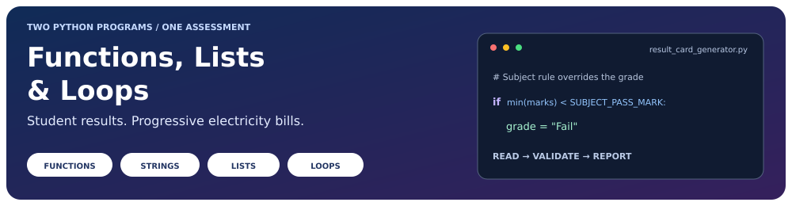
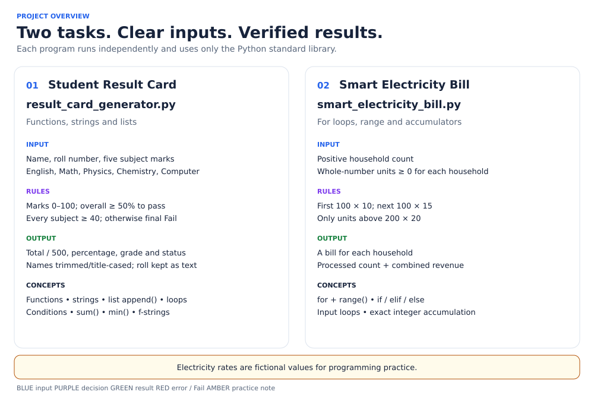
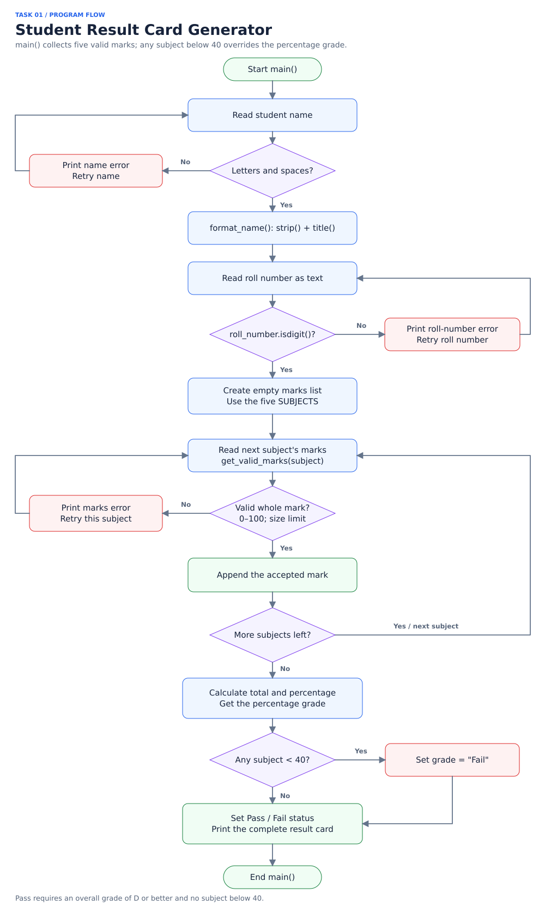
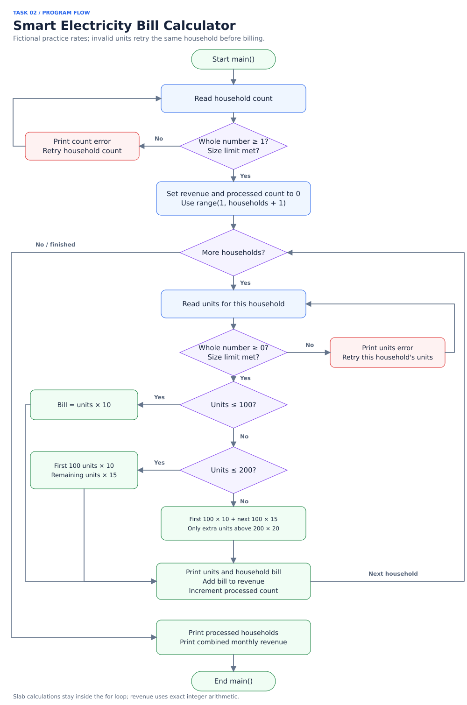
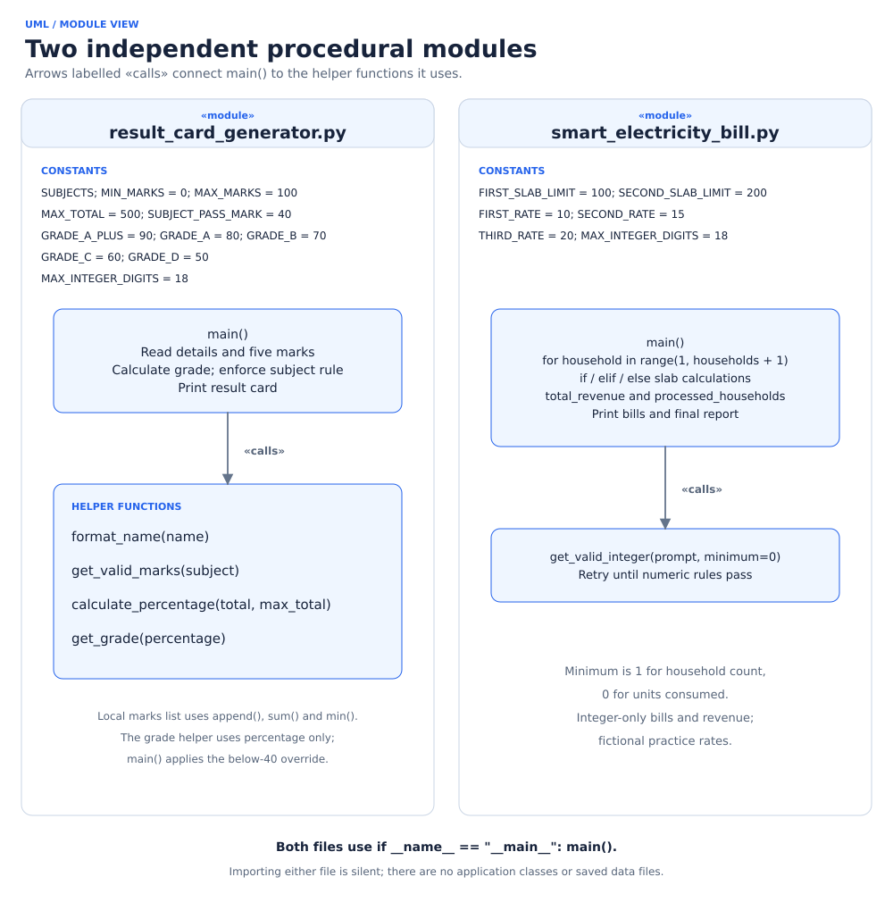

<p align="center"></p>

## 1. Project Overview

Two independent console programs apply Python fundamentals to student reporting and household billing. Each program validates input, performs its calculations, and prints a clear report.

| Task | File | Topics | Result |
| --- | --- | --- | --- |
| Student Result Card Generator | [result_card_generator.py](result_card_generator.py) | Functions, strings, lists, grading conditions | Five-subject total, percentage, grade, Pass/Fail |
| Smart Electricity Bill Calculator | [smart_electricity_bill.py](smart_electricity_bill.py) | for/range, validation loops, conditions, accumulators | Individual bills, completed count, combined revenue |



**83/83 checks passed · Python 3.12.14 · Verified 17 November 2026 · Standard library only**

[Requirements and source review](REQUIREMENTS.md) records the missing official brief, corrected README/task mismatch, assumptions and source changes.

## 2. Folder Structure

```text
python-functions-lists-assessment/
├── .github/
│   └── workflows/
│       └── tests.yml
├── assets/
│   ├── banner.png
│   ├── banner.svg
│   ├── overview.png
│   ├── overview.svg
│   ├── result_card_generator_flow.png
│   ├── result_card_generator_flow.svg
│   ├── smart_electricity_bill_flow.png
│   ├── smart_electricity_bill_flow.svg
│   ├── uml_diagram.png
│   └── uml_diagram.svg
├── tests/
│   ├── recorded_runs.json
│   ├── regression_evidence.json
│   ├── test_assessment.py
│   └── verification.txt
├── .gitignore
├── README.md
├── REQUIREMENTS.md
├── result_card_generator.py
└── smart_electricity_bill.py
```

Added folders: `assets/` holds the five SVGs and PNG renders; `tests/` holds runnable tests and captured evidence; `.github/workflows/` provides CI. `REQUIREMENTS.md` records the requirements and assumptions.

The ZIP's `previews/` and `source/` folders, upload checklist and verification note stay outside the repository. Upload the contents of the named repository folder to GitHub.

## 3.1. Task 1 — Student Result Card Generator

### Summary

`result_card_generator.py` reads one student's name, roll and five marks. The required helper functions clean names, validate marks, calculate a percentage and return a percentage grade. `main()` enforces the subject rule and prints the final card.

### Rules and Requirements

- Subjects are **English, Math, Physics, Chemistry and Computer**, each out of 100.
- Marks are whole numbers from **0 through 100**; the maximum total is **500**.
- Names contain letters/spaces and use `strip()` and `title()`.
- Roll identifiers satisfy `isdigit()` and stay as strings, preserving leading zeros.
- Passing requires **at least 50% overall** and **at least 40 in every subject**.
- A subject below 40 forces both the final grade and result to **Fail**, regardless of percentage.

| Percentage | Percentage grade |
| --- | --- |
| 90% or above | A+ |
| 80% to below 90% | A |
| 70% to below 80% | B |
| 60% to below 70% | C |
| 50% to below 60% | D |
| Below 50% | Fail |

### Program Flow

<details>
<summary>View the result-card flowchart</summary>



</details>

### Code Methods Description

| Method or section | Purpose |
| --- | --- |
| `SUBJECTS`, `MIN_MARKS`, `MAX_MARKS`, `MAX_TOTAL` | Define five subjects, valid mark range and total 500 |
| `SUBJECT_PASS_MARK` and grade constants | Keep the subject threshold and percentage cutoffs explicit |
| `MAX_INTEGER_DIGITS` | Bound integer conversion before calling `int()` |
| `format_name(name)` | Remove outer whitespace and apply title case |
| `get_valid_marks(subject)` | Repeat the current subject's prompt until a valid mark is entered |
| `calculate_percentage(total, max_total)` | Calculate the percentage; the app supplies a positive maximum of 500 |
| `get_grade(percentage)` | Return the percentage grade; subject failures are checked by the caller |
| `main()` | Validate identity, append five marks, calculate/override grade and print the card |
| `if __name__ == "__main__"` | Run the CLI directly while keeping imports silent |

### Input Validation

| Input | Accepted / handling |
| --- | --- |
| Name | Nonblank letters and ordinary spaces; invalid values retry |
| Roll | A nonempty string satisfying `isdigit()`; invalid values retry |
| Marks | Decimal whole-number text in 0–100; signs, fractions, text, blank input and non-decimal digit symbols retry |
| Long numeric text | Length checked before conversion; oversized input retries |

Names retain repeated internal spaces. Numeric marks support Unicode decimal digits. Roll values use the broader `isdigit()` rule and are never converted to integers. The full input-length and string-method boundaries are documented in [REQUIREMENTS.md](REQUIREMENTS.md).

### Expected Results

- Marks `89, 78, 90, 56, 80` produce **393/500**, **78.60%**, grade **B**, result **Pass**.
- Marks `39, 100, 100, 100, 100` produce **87.80%** but final **Fail**.
- Five marks of 40 produce **40.00%** and Fail; five marks of 50 produce **50.00%**, D and Pass.
- A mark of exactly 40 is permitted when the total still reaches the 50% pass threshold.

## 3.2. Task 2 — Smart Electricity Bill Calculator

### Summary

`smart_electricity_bill.py` bills a positive number of households. Its `for` loop visits each household, applies progressive slab conditions inside that loop, and accumulates revenue and completed bills.

**The rates are fictional values for programming practice.**

### Rules and Requirements

- Household count must be a whole number of **1 or more**.
- Units must be a whole number of **0 or more**.
- Charge the **first 100 units at Rs. 10**, the **next 100 at Rs. 15**, and **only units above 200 at Rs. 20**.
- Retry invalid input for the same household.
- Print each bill, then the processed-household count and total revenue.
- Use `for`, `range()`, `if/elif/else` and accumulators; integer arithmetic keeps these bills exact.

| Units `u` | Progressive bill |
| --- | --- |
| 0–100 | `u × 10` |
| 101–200 | `1000 + (u − 100) × 15` |
| Above 200 | `2500 + (u − 200) × 20` |

### Program Flow

<details>
<summary>View the electricity-bill flowchart</summary>



</details>

### Code Methods Description

| Method or section | Purpose |
| --- | --- |
| `FIRST_SLAB_LIMIT`, `SECOND_SLAB_LIMIT` | Define the 100-unit and 200-unit boundaries |
| `FIRST_RATE`, `SECOND_RATE`, `THIRD_RATE` | Define fictional rates 10, 15 and 20 |
| `MAX_INTEGER_DIGITS` | Limit numeric conversion after removing leading ASCII zeros |
| `get_valid_integer(prompt, minimum=0)` | Retry until the whole number meets its minimum and length rule |
| `main()` | Read count, loop over households, calculate bills, update accumulators and print the summary |
| `if __name__ == "__main__"` | Start the CLI only when executed directly |

### Input Validation

| Input | Accepted / handling |
| --- | --- |
| Household count | Whole number ≥ 1; zero, negatives, fractions, text and blanks retry |
| Units consumed | Whole number ≥ 0; invalid values retry within the same household |
| Oversized integer text | Reject before conversion; ask again |
| Surrounding spaces / leading ASCII zeros | Trim spaces, normalize leading zeros, then validate |

Both numeric fields allow at most 18 decimal digits after leading ASCII zeros are stripped. A household is counted after its bill is calculated, including a valid zero-unit bill.

### Expected Results

- **100 units → Rs. 1000**; **101 → Rs. 1015**.
- **200 units → Rs. 2500**; **201 → Rs. 2520**.
- Three households using **100, 150 and 250 units** produce bills **1000, 1750 and 3500**, totaling **Rs. 6250**.
- Zero units produce a zero bill and still count as a processed household.
- Correcting negative units does not skip that household.

## 4. UML Diagram

A **module diagram** fits the two procedural applications because it shows their real constants, functions and call relationships.



## 5. Concepts and Techniques Used

- **Functions:** `def`, parameters and return values separate reusable logic.
- **Strings:** `strip()`, `title()`, `replace()`, `isalpha()`, `isdigit()` and `isdecimal()` validate and format input.
- **Lists:** collect five subject marks with `append()`; calculate with `sum()` and `min()`.
- **Loops:** `while` retries inputs; `for` and `range()` process subjects/households.
- **Conditions:** grade cutoffs, the subject-fail override and progressive electricity slabs.
- **Accumulators:** total electricity revenue and completed-household count.
- **Formatting and constants:** f-strings, two-decimal percentages and named business rules.
- **Testability:** guarded `main()` functions, runnable `unittest` checks and real process/import checks.

## 6. How to Run

### Requirements

Python **3.10+**, a terminal, and Git only if cloning. Both applications and their tests use the standard library; no `pip install` step is needed. Local verification used **Python 3.12.14**.

After creating the repository on your GitHub account:

```bash
git clone https://github.com/muhammadadnancss1-ship-it/python-functions-lists-assessment.git
cd python-functions-lists-assessment
python result_card_generator.py
python smart_electricity_bill.py
```

Finish the first program's prompts before launching the second. You can also extract the ZIP and open a terminal inside the named repository folder.

| Launcher | Result card | Electricity bill |
| --- | --- | --- |
| macOS/Linux alternative | `python3 result_card_generator.py` | `python3 smart_electricity_bill.py` |
| Windows alternative | `py -3 result_card_generator.py` | `py -3 smart_electricity_bill.py` |

Run all tests:

```bash
python -m unittest discover -s tests -v
```

Or run `python tests/test_assessment.py` directly. Both imports are silent; another Python module can explicitly call either module's `main()`.

## 7. Sample Execution

The following transcripts come from passing runs of the delivered code. The test input reader echoes entered values; the application output is unchanged.

### Result Card — Success

<details>
<summary>Show the original worked example</summary>

```text
==================Result Card Generator================
Enter student name: Adnan
Enter roll number: 24
Enter marks for English: 89
Enter marks for Math: 78
Enter marks for Physics: 90
Enter marks for Chemistry: 56
Enter marks for Computer: 80

========== STUDENT RESULT CARD ==========
Student Name : Adnan
Roll Number  : 24
-----------------------------------------
English     : 89/100
Math        : 78/100
Physics     : 90/100
Chemistry   : 56/100
Computer    : 80/100
-----------------------------------------
Total Marks  : 393/500
Percentage   : 78.60%
Grade        : B
Result       : Pass
=========================================
```

</details>

### Result Card — A Failed Subject Overrides 87.80%

<details>
<summary>Show the high-percentage failure example</summary>

```text
==================Result Card Generator================
Enter student name: Adnan
Enter roll number: 24
Enter marks for English: 39
Enter marks for Math: 100
Enter marks for Physics: 100
Enter marks for Chemistry: 100
Enter marks for Computer: 100

========== STUDENT RESULT CARD ==========
Student Name : Adnan
Roll Number  : 24
-----------------------------------------
English     : 39/100
Math        : 100/100
Physics     : 100/100
Chemistry   : 100/100
Computer    : 100/100
-----------------------------------------
Total Marks  : 439/500
Percentage   : 87.80%
Grade        : Fail
Result       : Fail
=========================================
```

</details>

### Electricity Bill — Three-Household Success

<details>
<summary>Show the Rs. 6250 revenue example</summary>

```text
===== ELECTRICITY BILL SYSTEM =====
Practice rates only: these are not actual electricity tariffs.
Enter the number of households: 3

--- Household 1 ---
Enter electricity units consumed: 100
Units Consumed: 100
Electricity Bill: Rs. 1000

--- Household 2 ---
Enter electricity units consumed: 150
Units Consumed: 150
Electricity Bill: Rs. 1750

--- Household 3 ---
Enter electricity units consumed: 250
Units Consumed: 250
Electricity Bill: Rs. 3500

===== MONTHLY REVENUE REPORT =====
Households Processed: 3
Total Revenue: Rs. 6250
```

</details>

### Electricity Bill — Invalid Units and Recovery

<details>
<summary>Show negative units retried for the same household</summary>

```text
===== ELECTRICITY BILL SYSTEM =====
Practice rates only: these are not actual electricity tariffs.
Enter the number of households: 1

--- Household 1 ---
Enter electricity units consumed: -1
Invalid input! Enter a whole number of 0 or more with at most 18 significant digits.
Enter electricity units consumed: 100
Units Consumed: 100
Electricity Bill: Rs. 1000

===== MONTHLY REVENUE REPORT =====
Households Processed: 1
Total Revenue: Rs. 1000
```

</details>

## 8. Test Cases

**83/83 checks passed** on **Python 3.12.14**. Both applications and the test file compiled successfully. The suite contains **76 console scenarios, 3 helper checks and 4 subprocess/import checks**.

Each console scenario runs the actual application with a fully consumed scripted input sequence. Invalid values are entered one at a time. Table descriptions such as “5000 nines” mean literal digits, not scientific notation. Exact inputs and captured output are in [recorded runs](tests/recorded_runs.json); the [test log](tests/verification.txt) records all checks.

### Task 1 — 49 Checks

44 console scenarios, three helper checks and two process/import checks:

| # | Scenario | Inputs | Expected result |
| --- | --- | --- | --- |
| R01 | Original worked example | Adnan; roll 24; 89,78,90,56,80 | 393/500; 78.60%; B; Pass |
| R02 | Name formatting and leading-zero roll | Padded adnan ali; roll 001; all marks 80 | Adnan Ali; roll 001 retained; A/Pass |
| R03 | Numeric name | Name '123', then Ali; other fields valid | Name rejected once; corrected name accepted |
| R04 | Empty name | Name '', then Ali; other fields valid | Name rejected once; corrected name accepted |
| R05 | Spaces-only name | Name '   ', then Ali; other fields valid | Name rejected once; corrected name accepted |
| R06 | Alphanumeric name | Name 'Ali123', then Ali; other fields valid | Name rejected once; corrected name accepted |
| R07 | Punctuation in name | Name 'Ali-Khan', then Ali; other fields valid | Name rejected once; corrected name accepted |
| R08 | Alphabetic roll | Roll 'abc', then 001; other fields valid | Roll rejected once; 001 retained |
| R09 | Empty roll | Roll '', then 001; other fields valid | Roll rejected once; 001 retained |
| R10 | Alphanumeric roll | Roll '12A', then 001; other fields valid | Roll rejected once; 001 retained |
| R11 | Spaces-only roll | Roll '   ', then 001; other fields valid | Roll rejected once; 001 retained |
| R12 | Roll follows isdigit semantics | Superscript digit ² as roll; all marks 80 | Roll stays text; ² accepted by isdigit; A/Pass |
| R13 | Text mark | English 'abc', then 80; other marks 80 | Invalid mark rejected once; corrected marks give A/Pass |
| R14 | Negative mark | English '-1', then 80; other marks 80 | Invalid mark rejected once; corrected marks give A/Pass |
| R15 | Mark above 100 | English '101', then 80; other marks 80 | Invalid mark rejected once; corrected marks give A/Pass |
| R16 | Fractional mark | English '1.5', then 80; other marks 80 | Invalid mark rejected once; corrected marks give A/Pass |
| R17 | Empty mark | English '', then 80; other marks 80 | Invalid mark rejected once; corrected marks give A/Pass |
| R18 | Spaces-only mark | English '   ', then 80; other marks 80 | Invalid mark rejected once; corrected marks give A/Pass |
| R19 | Non-decimal digit regression | English '²', then 80; other marks 80 | Invalid mark rejected once; corrected marks give A/Pass |
| R20 | Unicode decimal marks | Arabic-Indic ٨٠ in every subject | Each mark converts to 80; 400/500; A/Pass |
| R21 | Oversized marks regression | 5000 nines, then 80; other marks 80 | Oversized mark rejected without conversion crash |
| R22 | Leading zeros before a mark | 5000 ASCII zeros followed by 80 | Leading zeros stripped safely; mark 80 accepted |
| R23 | All zero marks | 0,0,0,0,0 | 0/500; 0.00%; Fail |
| R24 | All maximum marks | 100,100,100,100,100 | 500/500; 100.00%; A+/Pass |
| R25 | Subject threshold alone is not enough | 40 in all five subjects | 40.00% overall; Fail even though no subject is below 40 |
| R26 | Just below overall pass threshold | 49,50,50,50,50 | 249/500; 49.80%; Fail |
| R27 | Exact overall pass threshold | 50 in every subject | 250/500; 50.00%; D/Pass |
| R28 | Exact subject pass threshold | 40,53,53,52,52 | One subject at 40; overall 50.00%; D/Pass |
| R29 | English fails alone | English 39; all other subjects 80 | Final grade and result become Fail |
| R30 | Math fails alone | Math 39; all other subjects 80 | Final grade and result become Fail |
| R31 | Physics fails alone | Physics 39; all other subjects 80 | Final grade and result become Fail |
| R32 | Chemistry fails alone | Chemistry 39; all other subjects 80 | Final grade and result become Fail |
| R33 | Computer fails alone | Computer 39; all other subjects 80 | Final grade and result become Fail |
| R34 | Several subject failures | 39,20,80,80,80 | Multiple subjects below 40; final Fail |
| R35 | High percentage cannot override a failed subject | 39,100,100,100,100 | 87.80% overall; final grade/result Fail |
| R36 | Exact 90% grade boundary | 90 in all subjects | 90.00%; A+/Pass |
| R37 | Just below 90% grade boundary | 89,90,90,90,90 | 89.80%; A/Pass |
| R38 | Exact 80% grade boundary | 80 in all subjects | 80.00%; A/Pass |
| R39 | Just below 80% grade boundary | 79,80,80,80,80 | 79.80%; B/Pass |
| R40 | Exact 70% grade boundary | 70 in all subjects | 70.00%; B/Pass |
| R41 | Just below 70% grade boundary | 69,70,70,70,70 | 69.80%; C/Pass |
| R42 | Exact 60% grade boundary | 60 in all subjects | 60.00%; C/Pass |
| R43 | Just below 60% grade boundary | 59,60,60,60,60 | 59.80%; D/Pass |
| R44 | Several invalid fields in one run | Bad name, bad roll, text/out-of-range English; then all 50 | All corrections requested; one D/Pass card |
| H01 | format_name helper | format_name('  aLI  khan  ') | Returns 'Ali  Khan'; preserves internal spaces |
| H02 | Percentage helper | calculate_percentage(393, 500) | Approximately 78.6 before display formatting |
| H03 | Percentage-only grade helper | get_grade(87.8) | Returns A; main() separately applies subject failures |
| P01 | Real result-card process | Scripted stdin for the original worked example | 78.60%; Pass; successful exit |
| P03 | Both imports are silent | Import each module while input is blocked | No prompts or output; both main functions callable |

### Task 2 — 34 Checks

32 console scenarios and two process/reuse checks:

| # | Scenario | Inputs | Expected result |
| --- | --- | --- | --- |
| E01 | Three-household worked example | 3 households; units 100,150,250 | Bills 1000,1750,3500; processed 3; revenue 6250 |
| E02 | Units boundary 0 | 1 household; 0 units | Bill/revenue Rs. 0; processed 1 |
| E03 | Units boundary 1 | 1 household; 1 units | Bill/revenue Rs. 10; processed 1 |
| E04 | Units boundary 99 | 1 household; 99 units | Bill/revenue Rs. 990; processed 1 |
| E05 | Units boundary 100 | 1 household; 100 units | Bill/revenue Rs. 1000; processed 1 |
| E06 | Units boundary 101 | 1 household; 101 units | Bill/revenue Rs. 1015; processed 1 |
| E07 | Units boundary 199 | 1 household; 199 units | Bill/revenue Rs. 2485; processed 1 |
| E08 | Units boundary 200 | 1 household; 200 units | Bill/revenue Rs. 2500; processed 1 |
| E09 | Units boundary 201 | 1 household; 201 units | Bill/revenue Rs. 2520; processed 1 |
| E10 | Units boundary 250 | 1 household; 250 units | Bill/revenue Rs. 3500; processed 1 |
| E11 | Units boundary 1000 | 1 household; 1000 units | Bill/revenue Rs. 18500; processed 1 |
| E12 | Zero households | Count '0', then 1; units 100 | Invalid count rejected once; one valid bill for Rs. 1000 |
| E13 | Negative households | Count '-1', then 1; units 100 | Invalid count rejected once; one valid bill for Rs. 1000 |
| E14 | Text household count | Count 'abc', then 1; units 100 | Invalid count rejected once; one valid bill for Rs. 1000 |
| E15 | Fractional household count | Count '2.5', then 1; units 100 | Invalid count rejected once; one valid bill for Rs. 1000 |
| E16 | Empty household count | Count '', then 1; units 100 | Invalid count rejected once; one valid bill for Rs. 1000 |
| E17 | Non-decimal household digit | Count '²', then 1; units 100 | Invalid count rejected once; one valid bill for Rs. 1000 |
| E18 | Negative units | 1 household; units '-1', then 100 | Retry the same household; processed 1; revenue Rs. 1000 |
| E19 | Text units | 1 household; units 'abc', then 100 | Retry the same household; processed 1; revenue Rs. 1000 |
| E20 | Fractional units | 1 household; units '1.5', then 100 | Retry the same household; processed 1; revenue Rs. 1000 |
| E21 | Empty units | 1 household; units '', then 100 | Retry the same household; processed 1; revenue Rs. 1000 |
| E22 | Non-decimal unit digit | 1 household; units '²', then 100 | Retry the same household; processed 1; revenue Rs. 1000 |
| E23 | Combined invalid count and units | abc,0,2 households; -1,bad,100 units; then 201 | Four errors; both households billed; revenue Rs. 3520 |
| E24 | Zero units included in processed count | 3 households; units 0,50,100 | Zero bill still counted; processed 3; revenue Rs. 1500 |
| E25 | All zero-unit households | 2 households; units 0,0 | Two households processed; revenue Rs. 0 |
| E26 | Oversized household count | 5000 nines, then 1; units 100 | Digit guard rejects input without a conversion crash |
| E27 | Oversized units | 1 household; 5000 nines, then 100 units | Digit guard retries; one bill for Rs. 1000 |
| E28 | Leading ASCII zeros | Count 0001; units 000150 | Count becomes 1; units become 150; revenue Rs. 1750 |
| E29 | Unicode decimal units | Count ٢; units ١٠٠ and ٢٠٠ | Two households; bills 1000/2500; revenue Rs. 3500 |
| E30 | Maximum integer input length | 1 household; 18 nines as units | Exact integer bill Rs. 19999999999999998480 |
| E31 | Nineteen-digit count | 19 nines, then 1; units 100 | Overlong count rejected once; valid count accepted |
| E32 | Whitespace around numeric input | Count ' 1 '; units ' 150 ' | Whitespace trimmed; one bill for Rs. 1750 |
| P02 | Real electricity process | 3 households; units 100,150,250 via stdin | Revenue Rs. 6250; processed 3; successful exit |
| P04 | Reuse both imported main functions | Import both; call their main functions with valid stdin | D/Pass card, Rs. 1000 bill, no data files |

[Regression evidence](tests/regression_evidence.json) compares the original conversion/counting defects with successful corrected runs. CI is configured for Python 3.10, 3.12 and 3.13; remote CI has not been run here.

---

**Author:** YOUR_NAME · **GitHub:** [muhammadadnancss1-ship-it](https://github.com/muhammadadnancss1-ship-it)
