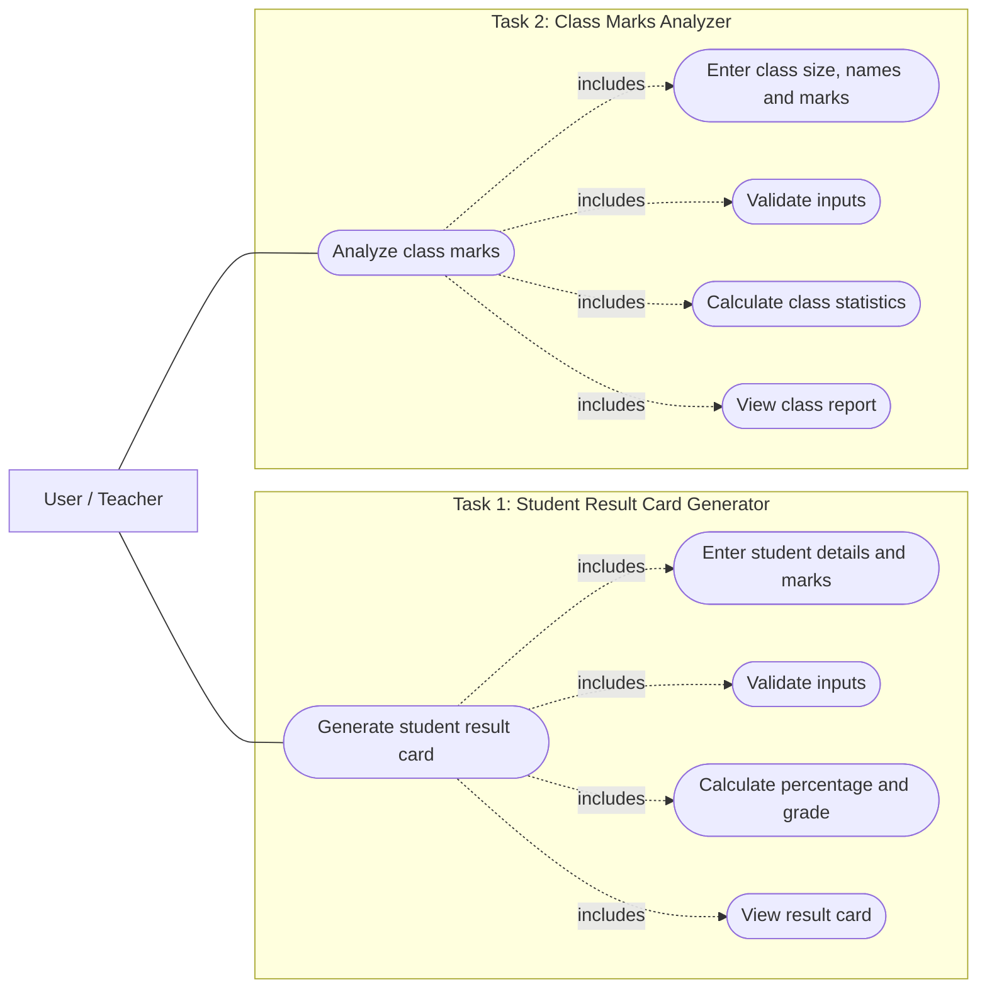

# Python Functions and Lists Assessment

Two simple Python programs for working with student marks. The first creates a **result card for one student**, while the second analyzes **the performance of a whole class**.

This project is part of the *Functions, Strings and Lists* assessment. It uses basic Python concepts such as functions, loops, conditions, strings and lists. Both programs run in the terminal and ask the user to enter information step by step.

## Project Overview

| Program | What it does |
| --- | --- |
| **Student Result Card Generator** | Takes a student's name, roll number and marks in five subjects. It calculates the total, percentage, grade and Pass/Fail result. |
| **Class Marks Analyzer** | Takes names and marks for any positive number of students. It calculates the class average, highest and lowest marks, passing and failing counts, and sorted marks. |

## Project Structure

```text
python-functions-lists-assessment/
│
├── result_card_generator.py    # Task 1: Student result card
├── class_marks_analyzer.py     # Task 2: Class performance report
└── README.md                   # Project guide
```

## Use Case Diagram

The diagram shows the two main tasks a user can perform and the actions included in each task. It uses a GitHub-supported Mermaid diagram to illustrate the use cases.



## Task 1: Student Result Card Generator

**File:** `result_card_generator.py`

This program prepares a result card for a single student. The user enters the student's name and roll number, followed by marks in **English, Math, Physics, Chemistry and Computer**.

### How it works

1. The program asks for the student's name. It removes extra spaces and capitalizes the name correctly.
2. It asks for a roll number and accepts digits only.
3. It asks for marks in each of the five subjects. Each mark must be a whole number from **0 to 100**.
4. It adds the marks and calculates the percentage out of **500**.
5. It assigns a grade using the percentage. **If the student scores below 40 in even one subject, the final grade and result are Fail**, regardless of the overall percentage.
6. It prints the result card with the student's details, subject marks, total, percentage, grade and final status.

### Grading Rules

| Percentage | Grade |
| --- | --- |
| 90% and above | A+ |
| 80% to below 90% | A |
| 70% to below 80% | B |
| 60% to below 70% | C |
| 50% to below 60% | D |
| Below 50% | Fail |

> **Important:** A student must also score **at least 40 marks in every subject** to pass. For example, a student with 75% overall but 38 marks in Chemistry will receive **Fail**.

### Functions Used

| Function | Purpose |
| --- | --- |
| `format_name(name)` | Removes extra spaces and capitalizes the student's name using `.strip()` and `.title()`. |
| `get_valid_marks(subject)` | Asks for subject marks until a valid number from 0 to 100 is entered. |
| `calculate_percentage(total, max_total)` | Calculates the percentage from obtained marks and maximum marks. |
| `get_grade(percentage)` | Returns the letter grade based on the percentage. |

### Example Run

```text
==================Result Card Generator================
Enter student name: 34
Invalid name! Please enter letters only.
Enter student name: Adnan
Enter roll number: 24
Enter marks for English: 89
Enter marks for Math: 78
Enter marks for Physics: 90
Enter marks for Chemistry: 56
Enter marks for Computer: 80

========== STUDENT RESULT CARD ==========
Student Name : Adnan
Roll Number  : 24
-----------------------------------------
English     : 89/100
Math        : 78/100
Physics     : 90/100
Chemistry   : 56/100
Computer    : 80/100
-----------------------------------------
Total Marks  : 393/500
Percentage   : 78.60%
Grade        : B
Result       : Pass
=========================================
```

Here, the total is **393 out of 500**, which gives **78.60%**. All five subject marks are at least 40, so the final result is **Pass** with grade **B**.

## Task 2: Class Marks Analyzer

**File:** `class_marks_analyzer.py`

This program helps a teacher review the marks of an entire class. The user chooses how many students to enter, then provides a name and **one mark out of 100 for each student**.

### How it works

1. The program asks for the number of students. It must be a whole number greater than zero.
2. For each student, it asks for a name and a mark from **0 to 100**.
3. It stores the names in `student_names = []` and the marks in `student_marks = []`, using `.append()`.
4. It calculates the average, highest marks and lowest marks.
5. It counts students who **passed (50 or above)** and **failed (below 50)**.
6. It identifies every student tied for the highest or lowest marks, and lists students scoring **above** the class average.
7. It displays the marks sorted from highest to lowest.

### Functions Used

| Function | Purpose |
| --- | --- |
| `get_valid_marks()` | Keeps asking for a valid student mark from 0 to 100. |
| `calculate_average(marks)` | Uses `sum()` and `len()` to calculate the average mark. |

### List Operations Used

| Python feature | How it is used |
| --- | --- |
| `[]` | Creates the two empty lists for names and marks. |
| `.append()` | Adds each student's name and mark. |
| `len()` | Finds the number of students and helps calculate the average. |
| `sum()` | Adds all class marks together. |
| `max()` | Finds the highest mark. |
| `min()` | Finds the lowest mark. |
| `sorted(..., reverse=True)` | Arranges the marks from highest to lowest. |

### Example Run

```text
================== Class Marks Analyzer ==================
Enter number of students: 5

Student 1
Enter student name: Adnan
Enter student marks: 90\
Invalid marks! Please enter numbers only.
Enter student marks: 90

Student 2
Enter student name: umar
Enter student marks: 78

Student 3
Enter student name: ali
Enter student marks: 78

Student 4
Enter student name: rehman
Enter student marks: 45

Student 5
Enter student name: ahmad
Enter student marks: 89

========== CLASS MARKS REPORT ==========
Total Students   : 5
Class Average    : 76.00
Highest Marks    : 90
Lowest Marks     : 45
Passing Students : 4
Failing Students : 1

Students with Highest Marks:
Adnan : 90

Students with Lowest Marks:
Rehman : 45

Students Above Class Average:
Adnan : 90
Umar : 78
Ali : 78
Ahmad : 89

Marks Sorted (Highest to Lowest):
90
89
78
78
45

========================================
```

### Understanding the Class Report

| Student | Marks | Status | Above class average? |
| --- | ---: | --- | --- |
| Adnan | 90 | Pass | Yes |
| Umar | 78 | Pass | Yes |
| Ali | 78 | Pass | Yes |
| Rehman | 45 | Fail | No |
| Ahmad | 89 | Pass | Yes |

- **Class average:** `(90 + 78 + 78 + 45 + 89) / 5 = 76.00`
- **Highest:** 90, achieved by Adnan.
- **Lowest:** 45, achieved by Rehman.
- **Pass / Fail:** 4 students passed and 1 student failed.
- **Above average:** Four students scored more than 76.
- **Sorted marks:** `90, 89, 78, 78, 45`.

> The class analyzer prints **sorted marks only**, as required. It does not rearrange the student-name list. When checking highest and lowest scores, it correctly displays all students who share those marks.

## Input Validation

Both programs ask the user to try again when an entry is invalid.

| Input | Accepted | Rejected |
| --- | --- | --- |
| Student name | `Adnan`, `adnan ali` | `34`, `Ali123`, empty name |
| Roll number (Task 1) | `24`, `001` | `abc`, `12A`, empty input |
| Marks | Whole numbers from `0` to `100` | `-5`, `101`, `hello`, `90\` |
| Number of students (Task 2) | `1`, `5`, `30` | `0`, `-2`, `abc` |

Names are formatted in title case, so `adnan ali` becomes `Adnan Ali`. The programs use string checks such as `.isdigit()` and `.isalpha()` before converting numeric input using `int()`. **Marks are entered as whole numbers**, not decimals.

## Python Concepts Practiced

- **Functions:** `def`, parameters, and `return` for reusable tasks.
- **Strings:** `input()`, `.strip()`, `.title()`, `.replace()`, `.isalpha()` and `.isdigit()`.
- **Lists:** Creating lists, adding entries and reading items by index.
- **Loops:** `while` loops for input validation and `for` loops for processing students and subjects.
- **Conditions:** `if`, `elif` and `else` for grading, validation and Pass/Fail decisions.
- **Built-in functions:** `int()`, `sum()`, `len()`, `max()`, `min()` and `sorted()`.
- **Output formatting:** f-strings for clear reports and percentages with two decimal places.

## How to Run the Programs

### Requirements

- Python 3 installed on your computer.
- A terminal, Command Prompt, PowerShell or VS Code terminal.
- No additional Python packages are needed.

### Steps

**1.** Download or clone this repository:

```bash
git clone https://github.com/waleedshehbazdev/python-functions-lists-assessment.git
```

**2.** Open the project folder:

```bash
cd python-functions-lists-assessment
```

**3.** Run Task 1:

```bash
python result_card_generator.py
```

**4.** Run Task 2:

```bash
python class_marks_analyzer.py
```

If `python` is not recognized on Windows, try `py` instead, for example: `py result_card_generator.py`.

> **Note:** The clone command works after the repository has been created on GitHub and the three project files have been uploaded.

## Testing Scenarios

These are useful cases to check when demonstrating the programs:

| Test | Expected behavior |
| --- | --- |
| Enter `123` as a student name | An error appears and the program asks for a name again. |
| Enter letters in a roll number | Task 1 asks for a digits-only roll number. |
| Enter `120` or `abc` as marks | The program rejects the value and asks again. |
| Score below 40 in one Task 1 subject | Final grade and result are Fail, even if the overall percentage is high. |
| Enter `0` as the class size | Task 2 asks for a positive number of students. |
| Give two students the same highest marks | Task 2 lists both students under highest marks. |
| Enter students with marks below and above 50 | Task 2 counts passing and failing students correctly. |

## Summary

These two programs demonstrate how basic Python features can solve everyday academic tasks. The **Student Result Card Generator** calculates and displays one student's result, while the **Class Marks Analyzer** provides a clear summary of a class's performance. Both programs focus on simple logic, understandable code and useful input checks.
